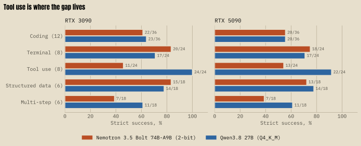
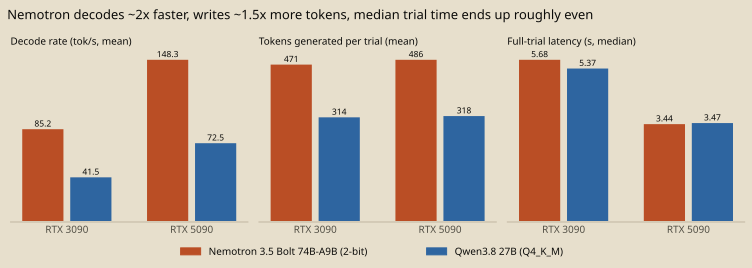

# Results

## Strict task success

| GPU | Model | Success / assignments | Rate | 95% task-cluster bootstrap CI |
|---|---|---:|---:|---:|
| RTX 3090 | Nemotron | 75/120 | 62.5% | 49.2–75.0% |
| RTX 3090 | Qwen | 89/120 | 74.2% | 61.7–85.0% |
| RTX 3090 | Both | 164/240 | 68.3% | task-cluster 56.7–79.2% |
| RTX 5090 | Nemotron | 71/120 | 59.2% | 45.8–72.5% |
| RTX 5090 | Qwen | 84/120 | 70.0% | 56.7–82.5% |
| RTX 5090 | Both | 155/240 | 64.6% | task-cluster 52.5–76.3% |

Paired aggregate difference (5090−3090): **−3.75 pp**, 95% task-cluster bootstrap CI **−8.75 to +0.83 pp**. Model-stratified differences: Nemotron **−3.33 pp** (CI −10.0 to +3.33); Qwen **−4.17 pp** (CI −10.0 to +0.83). These intervals include zero. Bootstrap resampling is by task, not individual trial.

## Category success

| Category | Tasks | Nemotron 3090 | Nemotron 5090 | Qwen 3090 | Qwen 5090 |
|---|---:|---:|---:|---:|---:|
| Coding | 12 | 22/36 (61.1%) | 20/36 (55.6%) | 23/36 (63.9%) | 20/36 (55.6%) |
| Terminal/system | 8 | 20/24 (83.3%) | 18/24 (75.0%) | 17/24 (70.8%) | 17/24 (70.8%) |
| Tool use | 8 | 11/24 (45.8%) | 13/24 (54.2%) | 24/24 (100%) | 22/24 (91.7%) |
| Structured data | 6 | 15/18 (83.3%) | 13/18 (72.2%) | 14/18 (77.8%) | 14/18 (77.8%) |
| Multi-step | 6 | 7/18 (38.9%) | 7/18 (38.9%) | 11/18 (61.1%) | 11/18 (61.1%) |

## Complete-task latency and throughput

| GPU | Model | Mean / median / p95 full trial (s) | Prompt tok/s | Decode tok/s |
|---|---|---:|---:|---:|
| RTX 3090 | Nemotron | 6.65 / 5.68 / 14.74 | 833.2 | 85.2 |
| RTX 3090 | Qwen | 8.58 / 5.37 / 24.61 | 963.4 | 41.5 |
| RTX 5090 | Nemotron | 4.19 / 3.44 / 11.26 | 1053.0 | 148.3 |
| RTX 5090 | Qwen | 5.18 / 3.47 / 13.78 | 1246.7 | 72.5 |

Throughput is the arithmetic mean of per-trial prompt/decode rates. Complete-trial latency includes all model responses and any tool turns; it is not decode throughput.

## Memory, GPU time, cost

| GPU | Model | Peak VRAM (MiB) | Peak container RAM (GiB) | Generation GPU-hours |
|---|---|---:|---:|---:|
| RTX 3090 | Nemotron | 21,339 | 47.52 | 0.2218 |
| RTX 3090 | Qwen | 16,481 | 47.26 | 0.2858 |
| RTX 5090 | Nemotron | 21,865 | 46.87 | 0.1397 |
| RTX 5090 | Qwen | 16,514 | 47.55 | 0.1726 |

Allocated GPU time was 0.720 h on RTX 3090 at $0.50/h ($0.36 estimated) and 0.498 h on RTX 5090 at $1.19/h ($0.59 estimated). The pair totals 1.218 h and $0.953 estimated. Successes per allocated GPU-hour: 227.8 (3090), 311.0 (5090). Rental estimates use provider-reported uptime and quoted rates; the corrected 5090 invoice detail was unavailable, so these are not settled charges.

## Paired task agreement and differences

Binary trial assignment agreement was **207/240 (86.25%)** across both models. Nemotron agreement was 100/120 (83.3%, Cohen κ=.651); Qwen 107/120 (89.2%, κ=.731). There were 21 3090-only successful assignments and 12 5090-only. Per-task success counts and all disagreement rows are in `DATA/task-comparisons.csv` and `DATA/outcome-disagreements.csv`.

The observed differences were response/scorer-contract differences, not runtime failures or CPU offload. Examples: Qwen CO11 repetition 1 on 5090 generated a conditional expression rejected by the frozen restricted-Python AST scorer; Qwen TO05 repetition 2 made out-of-order extra tool calls before returning the same final JSON that passed on 3090, and strict tool sequence scoring rejected it. The full 33 flips and classifications are in the disagreement CSV. These examples do not establish a GPU cause.
