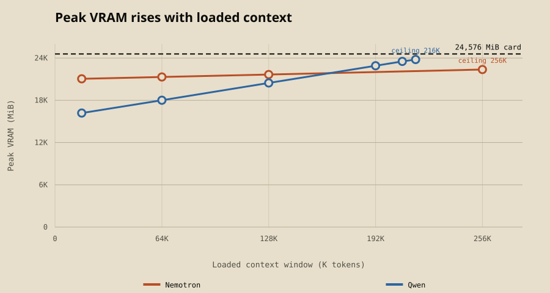
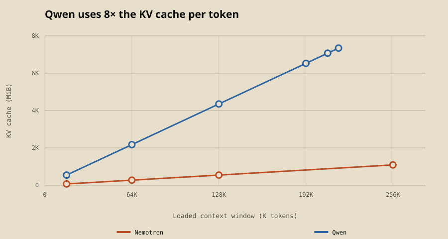
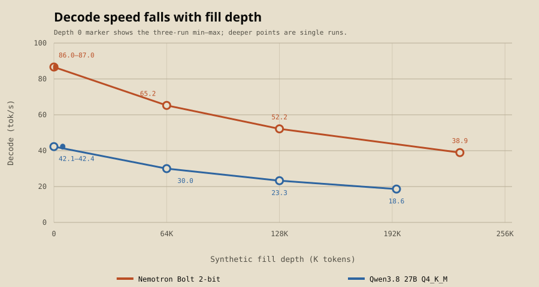
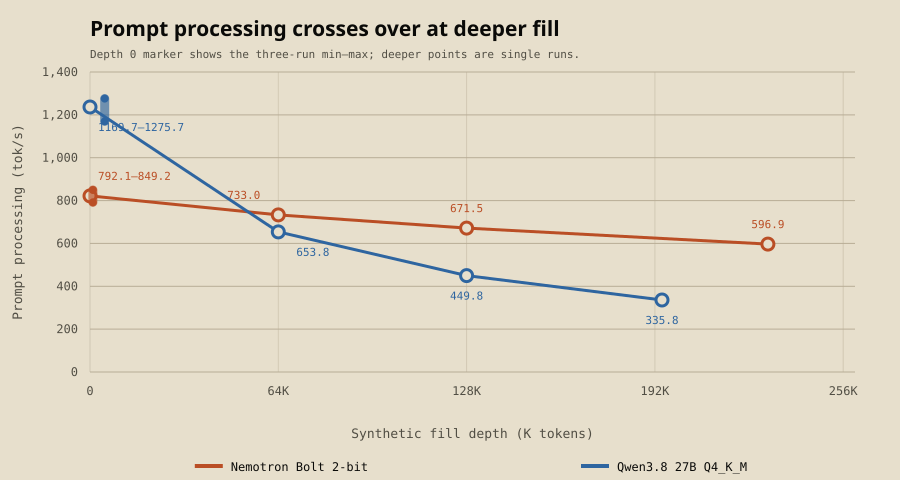

# NVIDIA's 2-bit Nemotron Bolt fits its full 256K context on a 24GB RTX 3090. Qwen3.8 27B tops out at 216K.

*CUDA Recipes 002*

[CUDA Recipes 001](/research/cuda-recipes-001) ran both models at 16K context, and the first thing people asked was what happens at real context sizes. Fair question. Most people running these for coding or agents want 64K, 128K, or as much as they can get.

So we took the exact same two files, the same llama.cpp build and the same settings, put them back on an RTX 3090, and changed one thing: the context window. Then we filled it up and watched what happened to speed.

The short version: Bolt fits its entire 256K native context on a 24GB card with room to spare, and it holds its speed better as the context fills. Qwen runs out of room at 216K.

## TL;DR

- **Bolt fits the full 256K on a 3090.** All 89 layers on the GPU at 262,144 tokens, its native maximum. Peak VRAM 22,366 MiB, leaving about 2.2 GB free.
- **Qwen tops out at 216K.** Its largest full-GPU load was 221,184 tokens (23,794 MiB peak, 782 MiB free). 229,376 failed.
- **The reason is the KV cache.** Qwen's costs about 34 KB per token and Bolt's about 4.3 KB, exactly 8x apart. At 128K that's 4.3 GB for Qwen vs 544 MB for Bolt.
- **Decode slows down for both as the context fills.** Bolt goes from 86.6 tok/s empty to 52.2 at 128K. Qwen goes from 42.3 to 23.3. Bolt at 128K still generates faster than Qwen with an empty context.
- **Prompt processing is where they really split.** Qwen reads prompts faster with an empty context (1,237 vs 822 tok/s), but by 64K Bolt is ahead, and at 128K Bolt keeps 82% of its prompt speed while Qwen keeps 36%.
- **Whole run cost about $0.43** in rented GPU time.

This is fit and speed only. We didn't test whether either model actually *uses* 128K of context well. More on that below.

## Setup

Everything is carried over from 001 except the context size.

- **Models:** NVIDIA Nemotron 3.5 Bolt 74B-A9B 24GB (official native 2-bit GGUF) and Qwen3.8 27B Q4_K_M (third-party GGUF of Qwen's upstream model). Same pinned files and SHA-256 hashes as 001.
- **Runtime:** llama.cpp commit `620d2225`, built for the 3090 (sm_86).
- **Settings:** `--parallel 1 -b 512 -ub 128 --cache-type-k q8_0 --cache-type-v q8_0 -ngl 999 --flash-attn on`. Every layer on the GPU, no CPU offload. A context only counts as "fits" if the server finishes loading with all layers on CUDA.
- **Hardware:** one RunPod RTX 3090 24GB.

Two separate measurements:

1. **Does it fit?** Load llama-server at 16K (an anchor back to 001), 64K, 128K and 256K, and record the VRAM it takes. If a size fails, binary-search for the largest size that still loads.
2. **How fast is it as the context fills?** llama-bench with the context pre-filled to 0, 64K and 128K tokens, plus a deep fill at 90% of each model's ceiling. At each depth we measure prompt processing (a 512-token prompt) and decode (128 generated tokens).

## The recipe

Tested on an RTX 3090 24GB (headless, nothing else on the GPU).

**Build llama.cpp at the tested commit**
```sh
git clone https://github.com/ggml-org/llama.cpp && cd llama.cpp
git checkout 620d2225cc436ab0b001e3200e590e3b286ef9ab
cmake -B build -DGGML_CUDA=ON -DCMAKE_CUDA_ARCHITECTURES=86
cmake --build build --config Release -j
```

**Download the exact files**
```sh
huggingface-cli download nvidia/NVIDIA-Nemotron-3.5-Bolt-74B-A9B-24GB-GGUF \
  NVIDIA-Nemotron-3.5-Bolt-74B-A9B-24GB.gguf \
  --revision e0fecb69cb3e5e4c5e8a056fa2aec98c78e91246 --local-dir models
huggingface-cli download Abiray/Qwen3.8-27B-Q4_K_M-GGUF \
  Qwen3.8-27B-Q4_K_M.gguf \
  --revision f7a1cda580fe828415151042bf9f3dc5bb8b0d76 --local-dir models
```

**Nemotron Bolt at its full 256K context** (peaked at 22,366 MiB)
```sh
./build/bin/llama-server -m models/NVIDIA-Nemotron-3.5-Bolt-74B-A9B-24GB.gguf \
  --ctx-size 262144 --parallel 1 -b 512 -ub 128 \
  --cache-type-k q8_0 --cache-type-v q8_0 -ngl 999 --flash-attn on --jinja
```

**Qwen3.8 27B Q4_K_M at 192K** (peaked at 22,908 MiB)
```sh
./build/bin/llama-server -m models/Qwen3.8-27B-Q4_K_M.gguf \
  --ctx-size 196608 --parallel 1 -b 512 -ub 128 \
  --cache-type-k q8_0 --cache-type-v q8_0 -ngl 999 --flash-attn on --jinja
```

Qwen's ceiling was 221,184 tokens, but that left only 782 MiB free on a headless card. If your 3090 also drives a display, 196,608 is the safer setting. If you're on a newer card than a 3090, change `CMAKE_CUDA_ARCHITECTURES` (e.g. 89 for 40-series, 120 for 50-series).

## Result 1: how much context fits



| Context | Bolt peak VRAM | Qwen peak VRAM |
|---:|---:|---:|
| 16K | 21,054 MiB | 16,190 MiB |
| 64K | 21,310 MiB | 18,012 MiB |
| 128K | 21,662 MiB | 20,460 MiB |
| 216K | | 23,794 MiB (ceiling) |
| 256K | 22,366 MiB (fits, native max) | doesn't fit |

The card has 24,576 MiB.

Bolt starts higher because its weights are bigger (a 22 GB file vs 16.8 GB), but its line is almost flat. Going from 16K to 256K adds only about 1.3 GB. Qwen starts nearly 5 GB lower and climbs steeply, then runs out of room a bit past 216K.

### Why: the KV cache is 8x different



Both models are hybrids, so only some of their layers keep a classic attention KV cache.

- **Bolt** is a Mamba-2/Transformer hybrid. Its Mamba layers keep a fixed-size state no matter how long the context is (about 165 MiB here), and its attention layers add only about **4.3 KB per token** with a Q8_0 cache.
- **Qwen3.8 27B** uses Gated DeltaNet (also fixed-size state, about 150 MiB) for most layers, with full attention every fourth block. Those attention layers cost about **34 KB per token**.

That's exactly 8x. At 128K, Bolt's KV cache is 544 MiB and Qwen's is 4,352 MiB. Add the compute buffers that grow with context too, and Qwen hits the wall first even though its weights are 5 GB smaller.

As a sanity check, the buffers llama.cpp reported (weights + KV + recurrent state + compute) add up to within 270–335 MiB of the VRAM we measured on every successful load. That leftover is normal CUDA overhead.

## Result 2: decode speed as the context fills



| Fill depth | Bolt decode | Qwen decode | Bolt / Qwen |
|---:|---:|---:|---:|
| 0 | 86.6 tok/s | 42.3 tok/s | 2.05x |
| 64K | 65.2 | 30.0 | 2.17x |
| 128K | 52.2 | 23.3 | 2.24x |
| 90% of ceiling | 38.9 (at 236K) | 18.6 (at 199K) | |

Depth 0 is the mean of 3 runs (Bolt 86.0–87.0, Qwen 42.1–42.4). Every deeper point is a single run.

Both lose decode speed at about the same rate. By 128K, Bolt is at 60% of its empty-context speed and Qwen is at 55%. Bolt's 2x advantage from 001 holds the whole way, and widens slightly.

The practical version: **Bolt at 128K (52 tok/s) still generates faster than Qwen does with an empty context (42 tok/s).**

## Result 3: prompt processing, where they cross over



| Fill depth | Bolt prompt | Qwen prompt | Bolt retained | Qwen retained |
|---:|---:|---:|---:|---:|
| 0 | 822 tok/s | 1,237 tok/s | | |
| 64K | 733 | 654 | 89% | 53% |
| 128K | 671 | 450 | 82% | 36% |
| 90% of ceiling | 597 (at 236K) | 336 (at 199K) | 73% | 27% |

This is the part we didn't expect to be this clear. With an empty context, Qwen reads prompts about 50% faster than Bolt. By 64K Bolt has passed it, and at 128K Bolt is about 1.5x faster. Qwen's prompt speed keeps falling as the context grows. Bolt's drops much more slowly, which lines up with how little attention state it carries (the same 8x gap as the KV cache).

What that means in practice: if you're adding new text to an already-long conversation, which is what agents and coding tools do constantly, every new chunk gets slower to read in on Qwen, and stays roughly the same speed on Bolt.

Filling the whole context from empty comes out about even up to 128K, because Qwen's fast start makes up for its slow finish. Interpolating between our measured points, it takes roughly 3 minutes either way on a 3090. That's a rough estimate, not something we timed directly.

## What this means if you run models locally

Scoped to these two files on a 3090:

1. **If you want 128K+ context on one 24GB card, Bolt has a lot more room.** It fits its full native 256K with 2.2 GB to spare. At 128K it peaked at 21,662 MiB (about 21.2 GB).
2. **Qwen3.8 27B Q4_K_M still fits 128K comfortably** (20,460 MiB, about 20 GB) and works up to about 216K with a Q8_0 KV cache. A smaller KV cache type would likely push that further. We didn't test that.
3. **For long agent sessions, Bolt's speed holds up better,** especially prompt processing. But remember [001](/research/cuda-recipes-001): Qwen was much more reliable at tool calling. Fitting more context doesn't fix that.
4. **Expect generation to slow down a lot by 128K.** Bolt kept 60% of its empty-context decode speed and Qwen kept 55%. Prompt processing held up much better on Bolt (82%) than on Qwen (36%). Judge a model by its speed at the context you'll actually use, not by its empty-context tok/s.

## What this doesn't tell you

- **Fit and speed only.** We didn't test whether either model can actually find or use information deep in a long context. That's a separate question, and arguably the more important one.
- **Synthetic fill.** llama-bench fills the context with synthetic tokens. Real documents and conversations might behave a bit differently.
- **One run per depth above 0.** Depth 0 had 3 runs with tight spread (within about 1 tok/s for decode). Deeper points are single runs, so we don't know their spread.
- **Settings weren't tuned for prompt speed.** We kept 001's settings, including `-ub 128`. A larger ubatch would very likely raise prompt-processing numbers for both models. Compare the two models to each other here, not to a tuned setup.
- **One card, one host, Q8_0 KV cache, no speculative decoding.** NVIDIA's own recipes for Bolt use DFlash speculative decoding, which we didn't use.
- **Not the same measurement as 001.** This run used a different driver (610.57.04 vs 580.126.20) and measured speed with llama-bench instead of 001's task harness. Bolt's 86.6 tok/s here and 85.2 in 001 are close, but they aren't directly comparable.
- **One excluded attempt.** Our runner's log reader crashed on the first 16K Bolt load (a text-encoding bug on our side). We fixed it and the retry loaded fine. It wasn't a model failure, and the failed attempt isn't in the data.

## Cost

0.867 GPU-hours on a RunPod RTX 3090 at the advertised $0.50/hour, so about **$0.43**, including download and build time. That's an estimate from uptime and list price, not an invoice.

## Data and reproducibility

Everything is in the [cuda-recipes repo, study 002](https://github.com/majorminorlabs/cuda-recipes/tree/main/002-context-ceiling):

- `DATA/load-results.csv`: every load attempt, including the failures, with model / KV / recurrent-state / compute buffer sizes and peak VRAM
- `DATA/bench-results.csv`: prompt and decode speed at every fill depth
- `DATA/study-config.json`, `METHODOLOGY.md`, `LIMITATIONS.md`
- Manifests for the models, llama.cpp build and host
- `validate.py`, `scripts/derived_stats.py` (every number in this article), and `scripts/make_charts.py`

**Pinned artifacts** (same as 001):

- Nemotron GGUF: `nvidia/NVIDIA-Nemotron-3.5-Bolt-74B-A9B-24GB-GGUF` @ `e0fecb69`, SHA-256 `91d63363…af75`
- Qwen GGUF: `Abiray/Qwen3.8-27B-Q4_K_M-GGUF` @ `f7a1cda5`, SHA-256 `6a96cc76…c867`
- llama.cpp `620d2225cc436ab0b001e3200e590e3b286ef9ab`

If you've run either of these at long context on your own card, we'd like to see how your numbers compare, especially with a bigger ubatch or a Q4 KV cache.
