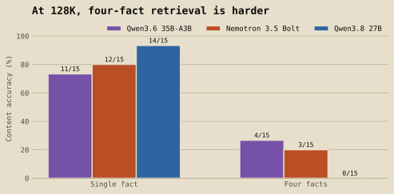
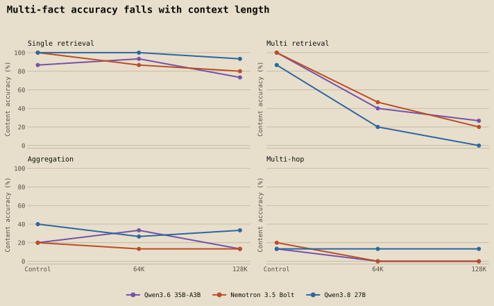
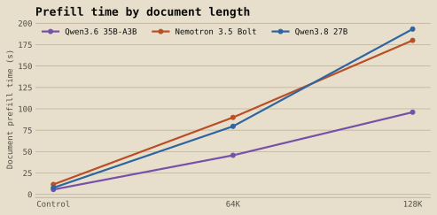

# Every model on a 3090 can find one fact in 128K of text. Ask for four and they fall apart.

*CUDA Recipes 003*

After [002](/research/cuda-recipes-002) showed how much context fits on a 24GB card, the obvious next question in the comments was: fine, but can the model actually *use* it? So we tested that.

Three models, one RTX 3090, documents of about 8K, 64K and 128K tokens. We planted made-up facts at known spots inside Moby-Dick and asked questions only those facts could answer. 540 scored answers, all scored by exact match, no AI judge.

Short version: all three are good at finding one thing in a long document. Ask them to find four things, count something, or follow a chain of facts, and it falls apart, mostly as the document gets longer, but in some cases even in short ones.

## TL;DR

- **All three fit 128K on a 3090** with every layer on the GPU (20,476 to 21,658 MiB peak).
- **Single fact at 128K:** Qwen3.8 27B 14/15, Nemotron Bolt 12/15, Qwen3.6 35B-A3B 11/15.
- **Four facts from the same document:** 13 to 15 out of 15 at 8K, 3 to 7 at 64K, 0 to 4 at 128K. Every model drops hard.
- **Counting and multi-step lookups are weak everywhere**, including the short 8K document (2 to 6 out of 15). That's a reasoning problem, not just a length problem.
- **Qwen3.6 reads long documents about twice as fast:** 96 seconds to read 128K tokens vs 180 to 193 for the other two. It also answered fastest.
- **Thinking mode backfired** in our first attempt. Qwen3.6 averaged 1,632 tokens of thinking per lookup and ran out of room on 100 of 180 questions. Details below.
- **Cost:** about $0.31 for the main run, plus about $0.75 for the thinking-mode attempt.

## The models

| Model | File | Notes |
|---|---|---|
| Nemotron 3.5 Bolt 74B-A9B | NVIDIA's native 2-bit GGUF | Same file as 001 and 002 |
| Qwen3.8 27B | Q4_K_M | Same file as 001 and 002 |
| Qwen3.6 35B-A3B | Q4_K_M | New. A mixture-of-experts model with about 3B active parameters |

Same llama.cpp build (`620d2225`) and server flags as 002, 131,072-token context window, Q8_0 KV cache, no CPU offload. All three loaded fully on the GPU at that window.

## How the test works

**The documents.** Text from Moby-Dick (public domain, Project Gutenberg), starting at Chapter 1 with no table of contents or front matter. We planted short made-up facts into the prose at recorded positions, like "The harbor pilot said that Ulma Wero was known for the quiet call upshzjdfsxkypca." The answers are random strings, so no model can know them from training or guess them from the question.

**Four kinds of question, 15 of each per document length:**

| Task | What it asks |
|---|---|
| Single retrieval | Find one planted fact |
| Multi retrieval | Find four planted facts scattered through the document |
| Aggregation | Count how many times a name appears |
| Multi-hop | Follow a three-step chain: person → berth → cove → signal |

The planted facts include near-miss decoys, so a model has to match the exact name. Every question was checked to make sure its answer can't be guessed from the question text.

**Scoring.** Exact match after trimming case and whitespace. Thinking was off, and answers were capped at 256 tokens. No answer came close to the cap. The document was read once per model and reused for every question (llama.cpp prompt caching, confirmed on all 177 follow-up questions per model).

## Result 1: finding one fact holds up well

| Single retrieval | 8K | 64K | 128K |
|---|---:|---:|---:|
| Qwen3.8 27B | 15/15 | 15/15 | 14/15 |
| Nemotron Bolt | 15/15 | 13/15 | 12/15 |
| Qwen3.6 35B-A3B | 13/15 | 14/15 | 11/15 |

If what you need is "find the clause in this contract" or "where did the logs mention X," all three handle it at 128K most of the time. Qwen3.8 27B was the most reliable. Position in the document didn't matter much. The worst case was Qwen3.6 on facts late in the document (11/15 across all lengths).

## Result 2: four facts at once collapses

| Multi retrieval (all 4 right) | 8K | 64K | 128K |
|---|---:|---:|---:|
| Qwen3.6 35B-A3B | 15/15 | 6/15 | 4/15 |
| Nemotron Bolt | 15/15 | 7/15 | 3/15 |
| Qwen3.8 27B | 13/15 | 3/15 | 0/15 |

This is the main finding. In a short document every model gets all four facts nearly every time. At 64K they get all four less than half the time, and at 128K almost never. Qwen3.8, the best at single facts, got zero at 128K.

That matters for anyone pasting a whole codebase or a long report into a local model and asking it to "list every place that does X." Finding *one* thing at long context isn't the same as finding *all* of them.

**A scoring note:** our prompt said `{"answers":[...]}` without saying whether the list should hold plain strings or objects. Many answers came back as objects like `{"shoal": "...", "tide_phrase": "..."}` with the right values in them. That ambiguity is ours, so these numbers count an answer as correct if the right four values are there in either format. Strict-format scores are published alongside them in the data. They're lower (0/3/0 at 128K), so under strict scoring the drop is even steeper.

## Result 3: counting and chaining are weak even when short

| | Aggregation 8K / 64K / 128K | Multi-hop 8K / 64K / 128K |
|---|---|---|
| Qwen3.6 35B-A3B | 3 / 5 / 2 | 2 / 0 / 0 |
| Nemotron Bolt | 3 / 2 / 2 | 3 / 0 / 0 |
| Qwen3.8 27B | 6 / 4 / 5 | 2 / 2 / 2 |

All out of 15. These are low across the board, including at 8K, so length isn't the main problem here. Without thinking, none of these models reliably counts mentions of a name or follows a three-step chain. About two-thirds of the wrong counts were off by one or two, and they undercounted more often than they overcounted. On multi-hop they mix up chains: Qwen3.8 swapped the answers to two different chain questions, and Nemotron gave the same wrong signal to two different ones.

One thing makes these tasks harder than real text: our made-up names are built from a small set of syllables, so "Havi Lumo" and "Lumo Havi" are both in the document as different entities. That's a deliberate decoy, but real documents are usually less confusing.

## Result 4: Qwen3.6 reads twice as fast

| Time to read the document | 8K | 64K | 128K |
|---|---:|---:|---:|
| Qwen3.6 35B-A3B | 5.7 s | 45.7 s | 96.1 s |
| Nemotron Bolt | 11.6 s | 90.0 s | 180.0 s |
| Qwen3.8 27B | 7.8 s | 79.6 s | 193.2 s |

Qwen3.6's 3B-active MoE design shows up clearly: it reads a 128K document in about a minute and a half, where the others take about three. After that first read, answers took 1.8 seconds on average (Qwen3.6), 2.5 (Bolt) and 3.2 (Qwen3.8).

## The thinking-mode attempt

Our first run had thinking on with a 2,048-token answer budget. Qwen3.6 went first. It averaged **1,632 tokens of thinking per question**, for lookups whose answer is one short string. It hit the cap on 100 of 180 questions. When it did finish with valid JSON, it was right 43 of 49 times. At that rate the other two models would have pushed the run to about 5.6 GPU-hours, so the run stopped itself after the first model, as designed.

We kept that run as a labeled exploratory result (`DATA/exploratory-thinking-on/`). We didn't save raw responses on that pass, so it can't be rescored. It's a real practical point, though: for simple lookups in long documents, thinking mode can burn your whole token budget before it answers.

## What this means if you run models locally

1. **One-fact lookups at 128K work** on all three, on a 3090.
2. **Don't trust any of them to find *everything*** in a 64K+ document in one shot. If you need every match, chunk the document or use search or tool-based retrieval.
3. **Counting and multi-step questions need help** even in short documents: thinking with a big budget, tools, or breaking the question into steps.
4. **For long-document speed, Qwen3.6 35B-A3B is the pick.** About half the read time of the others.
5. **For single-fact accuracy, Qwen3.8 27B was the most reliable** here.

## What this doesn't tell you

- **Planted facts in a novel**, not your contracts or code. Real documents could be easier or harder.
- **15 questions per cell**, one sample each. One question is 6.7 points, so a one-or-two-question gap between models is noise.
- **Thinking off.** Thinking might help counting and chaining, if you give it a much bigger budget than we could afford here.
- **One card, one llama.cpp build, Q8_0 KV cache, no speculative decoding.**
- **These exact GGUF files**, not every quantization of these models.

## Cost

Main run: 0.624 GPU-hours on a RunPod RTX 3090 at the advertised $0.50/hour, about **$0.31**. Thinking-mode attempt: about 1.49 GPU-hours, about **$0.75**. Both are estimated from uptime and list price.

## Data and reproducibility

Everything is in the [cuda-recipes repo, study 003](https://github.com/majorminorlabs/cuda-recipes/tree/main/003-context-quality): the frozen documents and questions with hashes, every planted fact's position, all 540 scored answers (content and strict-format), prefill and fit results, the scorer with its tests, `validate.py`, and `derived_stats.py`, which reproduces every number here.
