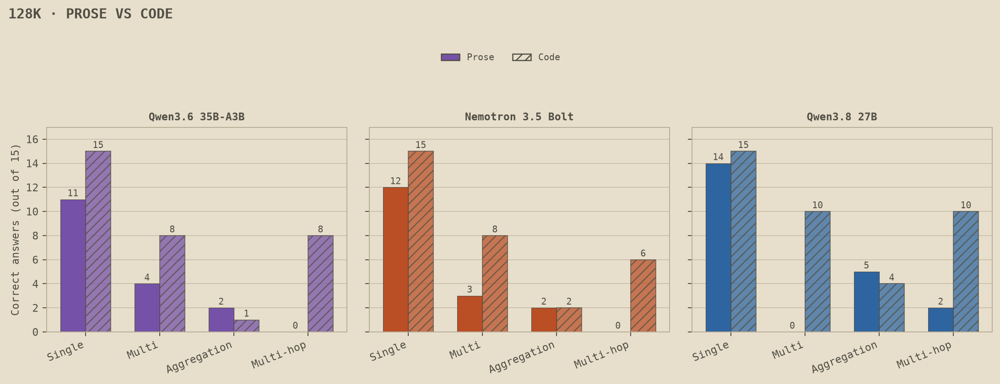
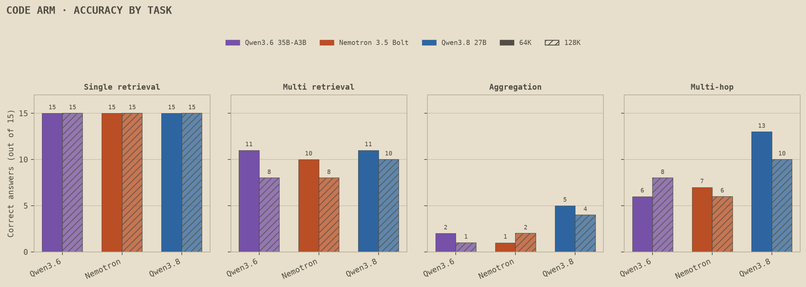
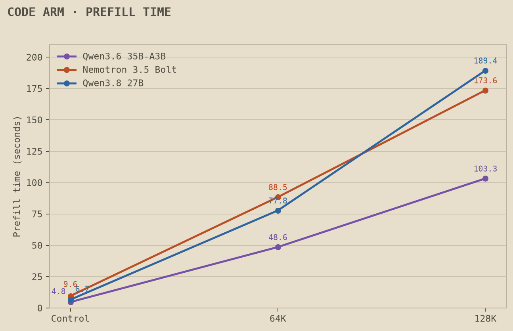

# Long context on a 3090: code holds up, prose falls apart, and none of them can count

*CUDA Recipes 003*

[002](/research/cuda-recipes-002) showed how much context fits on a 24GB card. The obvious follow-up in the comments was whether the model can actually *use* it. So we tested that, twice: once on a long novel and once on a real codebase, because most people running 128K locally are pasting in code, not books.

Three models, one RTX 3090, documents of about 8K, 64K and 128K tokens. We planted made-up items at known positions and asked questions only those items could answer. 1,080 answers, all scored by exact match, no AI judge.

## TL;DR

- **All three fit 128K on a 3090** with every layer on the GPU (20,476 to 21,658 MiB peak).
- **Finding one thing at 128K works.** In code, all three were 15/15 at every length. In prose, 11 to 14 out of 15.
- **Collecting four things is where prose falls apart.** At 128K: 0 to 4 out of 15 in prose, 8 to 10 out of 15 in code.
- **Tracing a short call chain through 128K of Django:** Qwen3.8 27B 10/15, Qwen3.6 8/15, Nemotron 6/15. The prose chain questions scored 0 to 2.
- **Nobody can count.** "How many times is this helper called?" scored 1 to 4 out of 15 at 128K, and wasn't much better in short documents.
- **Qwen3.6 35B-A3B reads long documents about twice as fast** (about 100 seconds for 128K vs about 3 minutes for the others).
- **Cost:** about $1.36 in rented GPU time for everything, including a thinking-mode attempt that didn't work out.

## The models

| Model | File | Notes |
|---|---|---|
| Nemotron 3.5 Bolt 74B-A9B | NVIDIA's native 2-bit GGUF | Same file as 001 and 002 |
| Qwen3.8 27B | Q4_K_M | Same file as 001 and 002 |
| Qwen3.6 35B-A3B | Q4_K_M | Mixture-of-experts, about 3B active parameters |

Same llama.cpp build (`620d2225`) and server flags as 002, 131,072-token context window, Q8_0 KV cache, no CPU offload. Thinking off, answers capped at 256 tokens. Each document was read once per model and reused for every question through llama.cpp prompt caching.

## How the test works

Two haystacks, same four kinds of question, 15 of each per length.

**Prose:** Moby-Dick (public domain), with short made-up facts planted into the text, like "The harbor pilot said that Ulma Wero was known for the quiet call upshzjdfsxkypca."

**Code:** Django source (BSD-3-Clause, commit `d4300847`), whole files concatenated with a `# file: path` header on each. We planted small Python snippets at boundaries between top-level statements, and every modified file still parses.

| Task | Prose version | Code version |
|---|---|---|
| Single retrieval | Find one planted fact | What string is assigned to `SETTING_x`? |
| Multi retrieval | Find four facts scattered through the document | Name the four functions decorated with `@register_x('tag_y')` |
| Aggregation | Count how many times a name appears | How many times is `lookup_x()` called? |
| Multi-hop | Follow a three-step chain: person → berth → cove → signal | `resolve_a()` calls `lookup_b()`, which returns `VALUE_c`. What's the string? |

Every task has look-alike decoys: similar names in prose, and things like `lookup_x_near()` and `SETTING_x_ALT` in code. Answers are random strings, so nothing can come from training data, and every question was checked to make sure its answer can't be guessed from the question.

One thing to know about the 8K documents: each one holds every planted item for its length, so it's crowded. About 47% of the prose 8K document and 77% of the code 8K document is planted text. Treat 8K as "can the model do this task at all," and compare 64K to 128K for the length effect.

## Result 1: finding one thing works

| Single retrieval | Prose 64K | Prose 128K | Code 64K | Code 128K |
|---|---:|---:|---:|---:|
| Qwen3.8 27B | 15/15 | 14/15 | 15/15 | 15/15 |
| Nemotron Bolt | 13/15 | 12/15 | 15/15 | 15/15 |
| Qwen3.6 35B-A3B | 14/15 | 11/15 | 15/15 | 15/15 |

In code, every model found every constant, early, middle or late in the document, at every length. "Where is X defined, and what's its value" across 128K of source works on all three.

## Result 2: collecting four things holds up in code, not in prose

| Multi retrieval (all four right) | Prose 8K / 64K / 128K | Code 8K / 64K / 128K |
|---|---|---|
| Qwen3.6 35B-A3B | 15 / 6 / 4 | 12 / 11 / 8 |
| Nemotron Bolt | 15 / 7 / 3 | 13 / 10 / 8 |
| Qwen3.8 27B | 13 / 3 / 0 | 11 / 11 / 10 |

In prose, all three collapse past 8K. Qwen3.8 goes from 13 to 0. In code, they slip but stay above half: 8 to 10 out of 15 at 128K.

Our best guess is that code is easier to search. A decorator with a unique tag is a very distinctive string, and a sentence buried in a novel isn't. That also means this is somewhat optimistic for real code, where names repeat constantly (more under limits).

A scoring note on prose: our prompt didn't say whether the list should hold plain strings or objects, and many prose answers came back as objects with the right values inside. That ambiguity is ours, so prose is scored on content, with strict-format scores published too (they're lower). We fixed the prompt for the code version, and there content and strict scores are identical.

## Result 3: tracing code works, chains in prose don't

| Multi-hop | Prose 8K / 64K / 128K | Code 8K / 64K / 128K |
|---|---|---|
| Qwen3.6 35B-A3B | 2 / 0 / 0 | 6 / 6 / 8 |
| Nemotron Bolt | 3 / 0 / 0 | 8 / 7 / 6 |
| Qwen3.8 27B | 2 / 2 / 2 | 15 / 13 / 10 |

Qwen3.8 27B is the standout here. It traced every call chain at 8K and 10 of 15 at 128K. The other two land around half.

The prose and code numbers aren't a clean domain comparison. The prose chain has three steps with deliberately confusable names ("Havi Lumo" and "Lumo Havi" are different people), and the code chain has two steps with unique identifiers. Both differences make code easier. What we can say is that a short "this calls that, which returns what?" trace across a big codebase is workable on a 3090, especially with Qwen3.8.

Qwen3.6's 8K score is dragged down by 5 answers where it started explaining its reasoning in plain text and ran out of its 256-token budget, which counts as wrong.

## Result 4: nobody can count

| Aggregation | Prose 8K / 64K / 128K | Code 8K / 64K / 128K |
|---|---|---|
| Qwen3.6 35B-A3B | 3 / 5 / 2 | 2 / 2 / 1 |
| Nemotron Bolt | 3 / 2 / 2 | 0 / 1 / 2 |
| Qwen3.8 27B | 6 / 4 / 5 | 6 / 5 / 4 |

"How many times is `lookup_x()` called?" with 2 to 8 real call sites. All out of 15. It's bad at every length, so this isn't mainly a long-context problem.

At 8K, a lot of the misses come from counting the decoy. Qwen3.6 counted calls to `lookup_x_near()` along with `lookup_x()` on 9 of 15. At 128K the counts look more like guesses. If you're asking a local model to "find all usages," use grep or your editor's references instead.

## Result 5: Qwen3.6 reads twice as fast

| Time to read the document | Prose 64K / 128K | Code 64K / 128K |
|---|---|---|
| Qwen3.6 35B-A3B | 45.7 s / 96.1 s | 48.6 s / 103.3 s |
| Nemotron Bolt | 90.0 s / 180.0 s | 88.5 s / 173.6 s |
| Qwen3.8 27B | 79.6 s / 193.2 s | 77.8 s / 189.4 s |

After that first read, answers came fast because the document stays cached: about 2.5 seconds for Qwen3.6, 3.8 for Bolt and 5.0 for Qwen3.8 at 128K on code. So the choice is real: Qwen3.6 is about twice as fast to load a big context, and Qwen3.8 is the better tracer.

## The thinking-mode attempt

Our first prose run had thinking on with a 2,048-token answer budget. Qwen3.6 went first and averaged **1,632 tokens of thinking per question**, for lookups whose answer is one short string. It ran out of room on 100 of 180 questions. When it did finish with valid JSON, it was right 43 of 49 times. Finishing the other two models would have taken about 5.6 GPU-hours, so the run stopped itself after the first model, as designed. We kept it as a labeled exploratory result (`DATA/exploratory-thinking-on/`) and ran everything else with thinking off.

## What this means if you code with a local model

1. **"Where is X and what is it" at 128K works** on all three, on a 3090.
2. **Short call-chain tracing is usable.** Qwen3.8 27B was best (10/15 at 128K). Check its answers anyway.
3. **"Find all the places that do X" is hit or miss.** 8 to 10 out of 15 at 128K in code, much worse in prose.
4. **Never trust a count.** Use grep, an LSP or a tool call.
5. **For speed, Qwen3.6 35B-A3B.** About half the read time. **For tracing, Qwen3.8 27B.**

## What this doesn't tell you

- **Planted items, not your real code.** The code identifiers are random strings like `lookup_wfwpewed`, which are easier to find than real names that repeat everywhere. This measures finding and tracing in a large codebase, not code understanding or writing code.
- **Prose and code tasks differ** in chain length and decoy style, so the gap between them isn't a pure "code vs prose" effect.
- **The 8K documents are crowded** with planted items (about 47% prose, 77% code), so they're a dense short version of the task, not a clean short-context baseline.
- **15 questions per cell**, one sample each. One question is 6.7 points, so a one-or-two-question gap is noise.
- **Thinking off.** Thinking might help counting and chaining, given a much bigger budget than we used.
- **One card, one llama.cpp build, Q8_0 KV cache, these exact GGUF files.**

## Cost

Prose run: 0.624 GPU-hours. Code run: 0.61 GPU-hours, including setup. Thinking-mode attempt: about 1.49 GPU-hours. On a RunPod RTX 3090 at the advertised $0.50/hour, that's about **$0.31 + $0.31 + $0.75 ≈ $1.36** total, estimated from uptime and list price.

## Data and reproducibility

Everything is in the [cuda-recipes repo, study 003](https://github.com/majorminorlabs/cuda-recipes/tree/main/003-context-quality): both frozen document sets and question sets with hashes, every planted item's position, all 1,080 scored answers (content and strict-format), prefill and fit results, the scorers with their tests, and `validate.py`. Django source is included under its BSD-3-Clause license, pinned to commit `d430084791a61b31cecec132bce3dca19194f7f2`.
