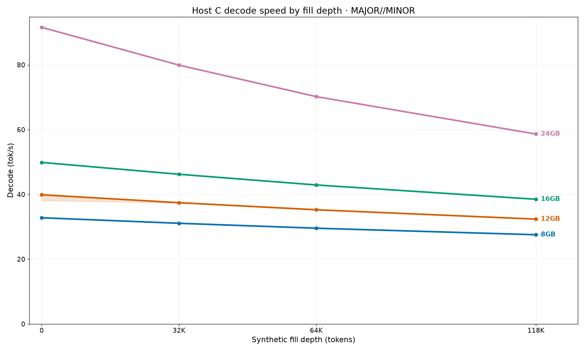
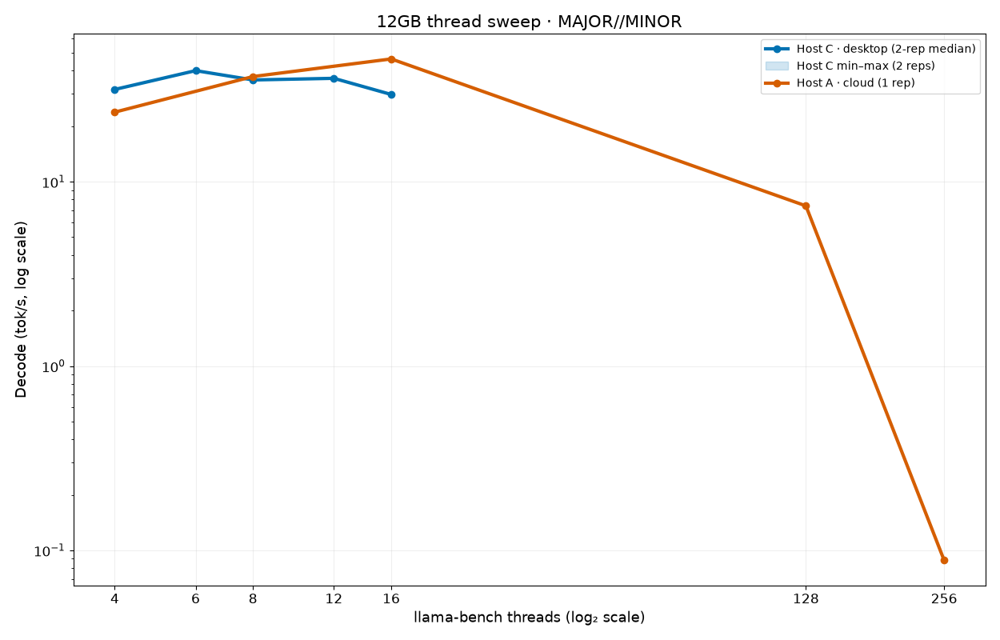
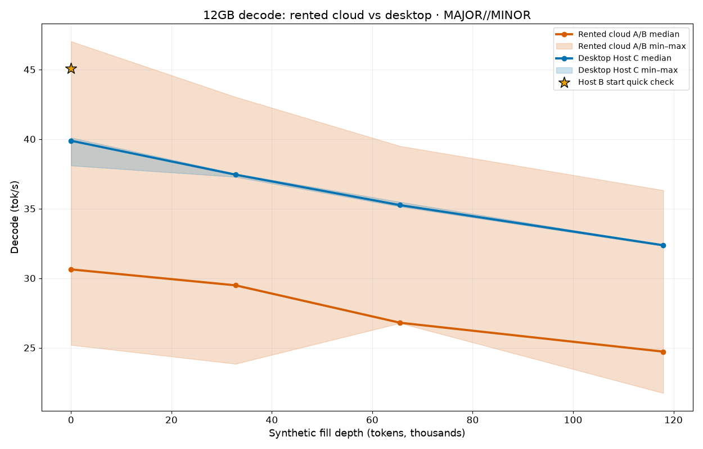
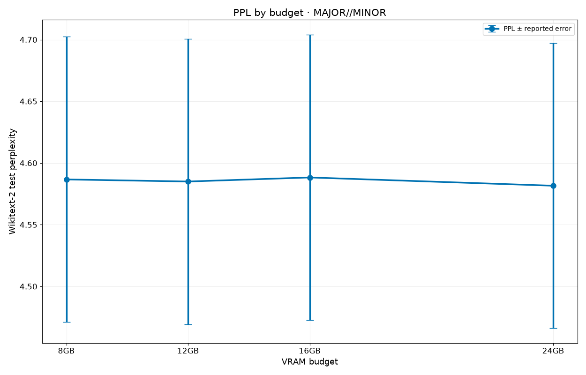

# Results

## Desktop Host C: main speed result

Host C was an Intel Core i5-11600K desktop CPU (6 cores/12 threads) with an 11.52-vCPU quota, or 96% of all 12 visible threads. The host had one RTX 3090 on PCIe Gen4 x16 and 64,125 MiB RAM (about 67.2 GB decimal). The 5-second bandwidth probes measured 39.8–40.7 GB/s; memory-module speed and channel count were unavailable from `dmidecode` and `lshw`. T=6 was selected from the two-rep thread sweep.

The chosen expert counts were 82/60/40/0 at 8/12/16/24GB. Each entry below is the median [minimum–maximum] across three Host C bench rounds. Depth is the prefill depth; prompt is PP and decode is TG.

| Budget | Depth | Decode median [min–max] | Prompt median [min–max] |
|---:|---:|---:|---:|
| 8GB | 0 | 32.78 [32.78–32.88] | 341.75 [341.08–342.78] |
| 8GB | 32,768 | 31.08 [30.99–31.10] | 344.02 [343.58–344.58] |
| 8GB | 65,536 | 29.56 [29.44–29.63] | 338.72 [337.57–339.61] |
| 8GB | 117,964 | 27.54 [27.53–27.60] | 329.95 [329.15–330.39] |
| 12GB | 0 | 39.88 [38.10–40.10] | 445.99 [444.33–446.25] |
| 12GB | 32,768 | 37.44 [37.28–37.52] | 436.86 [436.10–437.52] |
| 12GB | 65,536 | 35.25 [35.14–35.48] | 427.72 [426.66–429.02] |
| 12GB | 117,964 | 32.37 [32.31–32.39] | 410.25 [408.39–410.83] |
| 16GB | 0 | 49.87 [49.82–49.91] | 595.35 [594.11–596.60] |
| 16GB | 32,768 | 46.22 [46.06–46.28] | 583.49 [582.05–583.57] |
| 16GB | 65,536 | 42.91 [42.86–43.02] | 564.24 [563.57–565.20] |
| 16GB | 117,964 | 38.50 [38.42–38.53] | 532.16 [531.06–534.21] |
| 24GB | 0 | 91.59 [91.41–91.60] | 1,671.22 [1,659.01–1,672.53] |
| 24GB | 32,768 | 79.92 [79.79–79.95] | 1,570.40 [1,567.95–1,572.00] |
| 24GB | 65,536 | 70.19 [70.09–70.20] | 1,422.04 [1,421.44–1,424.00] |
| 24GB | 117,964 | 58.63 [58.62–58.67] | 1,240.77 [1,240.77–1,242.08] |

Host C bench-row peak VRAM at 117,964 tokens, by budget:

| Budget | N | Host C peak at 117,964 (3 reps) | Ceiling (budget − 500 MiB) | Margin below ceiling |
|---:|---:|---:|---:|---:|
| 8GB | 82 | 7,546 MiB | 7,692 MiB | 146 MiB under |
| 12GB | 60 | 11,644 MiB | 11,788 MiB | 144 MiB under |
| 16GB | 40 | 15,742 MiB | 15,884 MiB | 142 MiB under |
| 24GB | 0 | 21,872 MiB | 24,076 MiB | 2,204 MiB under |

No Host C peak exceeded the budget-minus-500-MiB ceiling. The 8/12/16GB load tests also passed at 128K; see [`load-results.csv`](DATA/load-results.csv).

The CSV value at 24GB / 65,536 depth is exactly **1,423.996657 prompt tok/s**; the formatted table value is 1,424.0. There is no `1,1,423.997` value in the CSV.

## Rented cloud hosts: 0, A, and B

Host 0 was an EPYC 7H12 with a 31.13-vCPU quota and supplied calibration, load, PPL, and the archived `-t 128` rows. Host A was an EPYC 7763 with a 31.13-vCPU quota and supplied the thread sweep and T=16 rep 1. Host B was an EPYC 7C13 with a 31.125-vCPU quota and supplied reps 2–3 plus a start-of-run quick check. The hosts exposed 256 threads while the cgroup quotas allowed about 31.1 vCPUs, so these were shared CPU slices.

Across the T=16 repetitions on hosts A/B and all four depths, the observed ranges were:

| Budget | Cloud decode range (A/B, all depths) | Cloud prompt range (A/B, all depths) |
|---:|---:|---:|
| 8GB | 21.65–40.33 tok/s | 353.63–432.01 tok/s |
| 12GB | 21.74–47.03 tok/s | 449.42–546.05 tok/s |
| 16GB | 37.02–59.17 tok/s | 480.99–625.07 tok/s |
| 24GB | 53.87–87.51 tok/s | 1,083.21–1,644.17 tok/s |

At 12GB and depth zero, host A rep 1 measured 47.03 decode tok/s. Host B's initial quick check measured 45.07, while its later reps measured 30.63 and 25.20 tok/s. That same-pod decline is consistent with shared-CPU contention. The full Host B values and host labels are in [`bench-results.csv`](DATA/bench-results.csv).

Host 0's archived default-`-t 128` rows:

| Budget | Depth | Prompt tok/s | Decode tok/s | Peak VRAM |
|---:|---:|---:|---:|---:|
| 8GB | 0 | 418.41 | 7.15 | 6,986 MiB |
| 8GB | 32,768 | 436.85 | 6.56 | 7,110 MiB |
| 8GB | 65,536 | 432.04 | 7.09 | 7,278 MiB |
| 8GB | 117,964 | 409.24 | 5.92 | 7,807 MiB (**over by 115 MiB**) |
| 12GB | 0 | 537.97 | 9.55 | 11,084 MiB |
| 12GB | 32,768 | 531.85 | 8.97 | 11,208 MiB |
| 12GB | 65,536 | 529.70 | 7.91 | 11,376 MiB |
| 12GB | 117,964 | 490.41 | 6.91 | 11,905 MiB (**over by 117 MiB**) |
| 16GB | 0 | 681.70 | 10.78 | 15,244 MiB |
| 16GB | 32,768 | 690.63 | 10.52 | 15,308 MiB |
| 16GB | 65,536 | 671.89 | 11.70 | 15,476 MiB |
| 16GB | 117,964 | 613.32 | 9.01 | 15,742 MiB |
| 24GB | 0 | 1,513.49 | 87.40 | 21,290 MiB |
| 24GB | 32,768 | 1,470.00 | 75.22 | 21,438 MiB |
| 24GB | 65,536 | 1,319.51 | 65.69 | 21,606 MiB |
| 24GB | 117,964 | 1,137.67 | 54.43 | 21,872 MiB |

At depth zero, the 8/12/16GB default-128 decode rates were 7.15/9.55/10.78 tok/s. The archived Host 0 8GB and 12GB 118K `-t 128` rows exceeded the budget-minus-500-MiB ceiling by 115 and 117 MiB, respectively. On Host A, the 12GB thread sweep measured 7.40 tok/s at 128 threads versus 46.36 tok/s at the best setting, about a 6.3× ratio within that single sweep; comparing the Host 0 12GB row to Host A's best thread setting gives about 4.9×. Raw 128-thread rows remain in `_internal/raw/bench-results-t128.csv`.

## Perplexity

Wikitext-2 test perplexity was effectively unchanged across the selected offload budgets: 4.5850–4.5883 for N>0 versus 4.5816 on the 24GB all-GPU baseline. Reported error is about 0.116. `--no-op-offload` was used for N>0 to exercise CPU expert execution. PPL was measured on host 0 only.

## Costs

RunPod RTX 3090 cost was calculated at $0.50/GPU-hour. The successful Vast Host C pod used the provider's $0.388889/hour rate. Vast search/trial attempts are listed separately as estimates from their recorded runtimes.

| RunPod run | GPU-hours | Cost at $0.50/GPU-hour |
|---|---:|---:|
| Initial calibration, load, and PPL collection | 0.860194 | $0.4301 |
| T=16 rep 1 and thread sweep | 1.094392 | $0.5472 |
| Repetitions 2–3 | 0.773540 | $0.3868 |
| **RunPod total** | **2.728126** | **$1.3641** |

| Vast successful run | GPU-hours | Cost |
|---|---:|---:|
| Host C desktop benchmark (includes build/fetch setup) | 1.714535 | $0.6668 |

| Vast search attempt | GPU-hours (estimated) | Cost (estimated) | Status |
|---:|---:|---:|---|
| 1_upper_bound | ≤0.235918 | ≤$0.1638 | runner_failed; stop confirmed before attempt 2 |
| 2 | 0.235980 | $0.1639 | failed |
| 3 | 0.477765 | $0.3318 | unknown |

| Estimated all-in total | GPU-hours | Cost |
|---|---:|---:|
| RunPod + successful Vast run + estimated Vast trials | 5.392324 | $2.6904 |

Vast trial attempt 1 is an upper-bound entry and attempt 3 has uncertain provider accounting status; the trial subtotal and all-in total are estimates. Costs are provider runtime multiplied by recorded list rates, not invoices.
