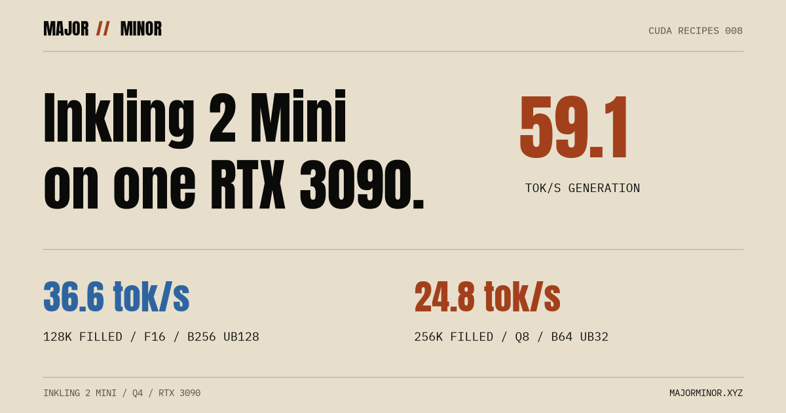
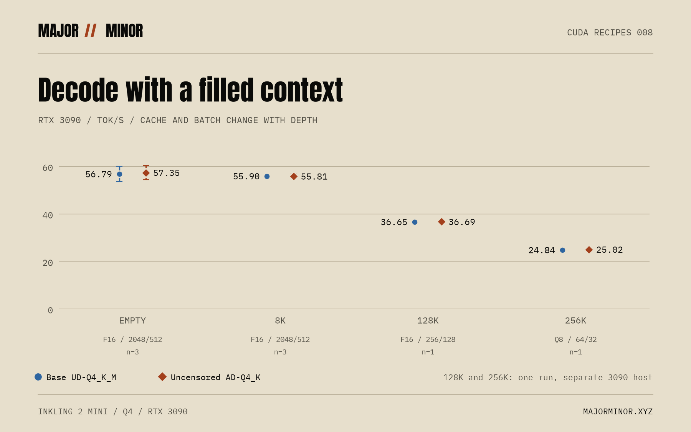

# CUDA Recipes 008: Inkling 2 Mini on an RTX 3090

Two Inkling 2 Mini Q4 files were benchmarked on a 24GB RTX 3090 using llama.cpp commit `19bc41dbb41e858eebc269b49ccdec1f0d28880c`. Unsloth UD-Q4_K_M measured 59.106860 tok/s at tg128; AtomicChat uncensored AD-Q4_K measured 58.713510 tok/s. Each primary measurement has three repetitions.

Default batch settings failed at large configured contexts. Reducing batch/ubatch enabled 128K with F16 KV and 256K with Q8 KV. A verified rerun measured filled-context decode at 36.646339 / 36.685906 tok/s at 128K and 24.842185 / 25.018935 tok/s at 256K, base / uncensored. Each deep point has one repetition, and the deep rerun used a separate RTX 3090 host.



## Measured rates

| Artifact | pp512 tok/s | tg128 tok/s | 128K F16, b256/ub128 | 256K Q8, b64/ub32 |
|---|---:|---:|---:|---:|
| Base UD-Q4_K_M | 1411.470954 | 59.106860 | 36.646339 | 24.842185 |
| Uncensored AD-Q4_K | 1454.322674 | 58.713510 | 36.685906 | 25.018935 |

`pp512` measures 512-token prompt processing. `tg128` measures 128-token generation. The separate depth benchmarks start with synthetic context already present. Context-load checks allocate a configured window and request a short response; they do not score recall over that window. `K` means 1,024 tokens.

## Contents

| File | Purpose |
|---|---|
| [METHOD.md](METHOD.md) | Inputs, builds, machines, statistics and reproduction |
| [RESULTS.md](RESULTS.md) | All 12 measurement rows and 14 context attempts |
| [FAILURES.md](FAILURES.md) | Allocation failures, successful tuning and lost-pod correction |
| [LIMITATIONS.md](LIMITATIONS.md) | Repetition, host, memory and quality limits |
| [COMMANDS.md](COMMANDS.md) / [run-index.json](run-index.json) | Expanded commands and 14 timing/behavior run records |
| [results.json](results.json) / [results.csv](results.csv) | Raw-derived measurement data and configuration |
| [models.json](models.json) / [systems.json](systems.json) | Artifact hashes and captured hardware/build records |
| [evidence-manifest.json](evidence-manifest.json) | Original and public content hashes for 274 compressed evidence files |
| [provenance.json](provenance.json) | Source/archive verification and provisional-run status |
| [CHARTS](CHARTS/) | Overview and decode-depth PNG/SVG graphics, renderer inputs and provenance |
| [VALIDATION.md](VALIDATION.md) | Package verification record |

## Findings

Both files placed their expert tensors in CUDA0. The base file includes 40 NVFP4 expert matrices. This llama.cpp build uses its CUDA Q8 MMQ path on Ampere when native Blackwell FP4 MMA is unavailable; the 3090 does not execute native Blackwell FP4 instructions.

Both artifacts failed default b2048/ub512 allocation checks at 128K F16 and 256K F16/Q8/FP8. Both passed 128K F16 with b256/ub128. At 256K Q8, b256/ub128 still failed; b64/ub32 passed. All 14 attempts remain available: ten allocation failures and four successful short-generation checks.



The initial 128K-depth attempts produced no measurement. A subsequent supplemental pod disappeared before its raw tree could be transferred. Its surviving summaries are provisional and are not selected results. The four verified deep rerun measurements replace them.

One explicit refusal prompt was captured for each file. The base refused and the uncensored file supplied a procedural response. This is a single behavioral observation, not a refusal-rate or quality benchmark. No scored accuracy, perplexity, vision or long-context retrieval evaluation is reported.

## Verify the package

From this study directory, without loading a model or accessing the network:

```sh
python3 scripts/validate.py
python3 scripts/rebuild_measurements.py --check
python3 scripts/summarize.py --check
shasum -a 256 -c SHA256SUMS
```

The checks match every numerical row to its raw JSON, rebuild the JSON/CSV measurement tables, check commands and configuration, and verify the evidence hashes. To inspect a log:

```sh
gzip -dc evidence/rtx3090/base_bench_pp512_tg128.stdout.log.gz
```

[Reproduction instructions](METHOD.md) use the exact GGUF hashes and pinned build. No script provisions a remote machine. Model weights, runtime binaries, environments, authentication and operational administration are not redistributed. Captured paths are normalized to `/study`; private identifiers are removed. Flags, numerical measurements, timestamps and error/output text remain unchanged, with original and public hashes recorded separately.

MAJOR//minor designed the tests; AI agents operated the runs and assembled the evidence. Code follows the repository's MIT license; results/data follow CC BY 4.0. Consult the upstream model cards and artifact licenses for Unsloth and AtomicChat. Bundled fonts retain their included OFL notices.
